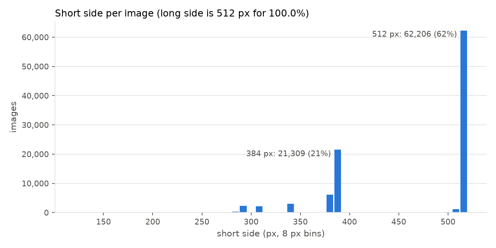
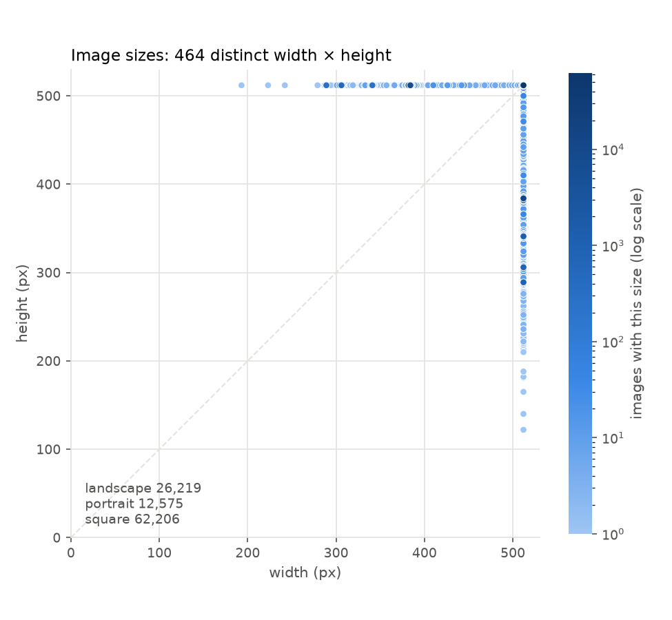
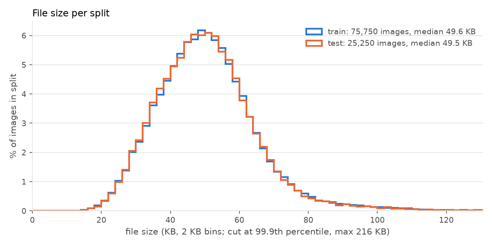
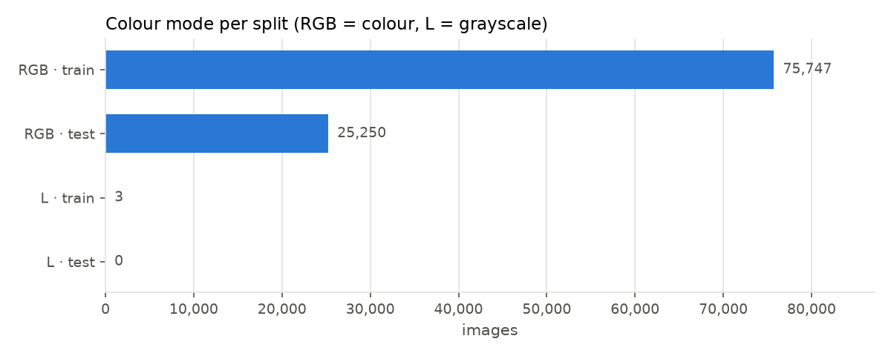

# image-dataset-audit

[](https://github.com/DaheeMATTANA/image-dataset-audit/actions/workflows/lint.yml)

A reproducible data-quality pipeline for image datasets. It checks dataset integrity, finds exact, near- and semantic duplicates, detects train/test leakage, and measures how much leakage changes a model's accuracy.

The first target is [Food-101](https://data.vision.ee.ethz.ch/cvl/datasets_extra/food-101/) (101,000 images, 101 classes), a standard benchmark used from training tutorials to the evaluation suites of large vision-language models. The pipeline is designed to scale to datasets of ~10M images and, later, to video.

> **Status:** in progress. Stage 1 (dataset profile) is done; see [Results](#results-food-101).

---

## Motivation

- **Duplicates waste compute and bias training:** the same image seen many times counts more than it should.
- **Train/test leakage inflates accuracy:** if a test image, or a resized copy of it, is also in the training set, the model is partly evaluated on memory rather than generalisation.
- **Label noise is a known property of Food-101:** the training set was left uncleaned by its authors, so the amount of noise has to be measured.

---

## Pipeline

| # | Stage | Method | Output | Status |
|---|---|---|---|---|
| 1 | Dataset profile | Split and metadata checks; formats, colour modes, resolutions, file sizes | Data profile | ✅ done |
| 2 | Corruption and exact duplicates | Full decode with Pillow, SHA-256 hashing | Corruption and exact-duplicate report | ⚪ planned |
| 3 | Near-duplicates | Perceptual hashing (dHash, pHash), Hamming distance, 200 hand-labelled pairs | Near-duplicate list with measured precision | ⚪ planned |
| 4 | Embeddings | Pretrained vision encoder (open_clip) | Embeddings for the full dataset | ⚪ planned |
| 5 | Semantic duplicates | Cosine similarity, threshold from a precision/recall curve | Semantic duplicates with precision and recall | ⚪ planned |
| 6 | Nearest-neighbour search at scale | Exact vs approximate search (FAISS) | Speed/recall trade-off table | ⚪ planned |
| 7 | Curation table | Columnar storage, one row per image, one column per signal | Parquet table | ⚪ planned |
| 8 | Leakage ablation | Linear probe on embeddings, original vs deduplicated split, 3 seeds | Accuracy difference with variance | ⚪ planned |
| 9 | Report and design doc | Constraints, options, decision, measured trade-offs | Audit report and design doc | ⚪ planned |

---

## Results: Food-101

Every number below is produced by a script in [`src/`](src/); full outputs are in [`reports/`](reports/).

### Stage 1: splits and metadata

Script: [`src/check_metadata.py`](src/check_metadata.py). Expected values come from the dataset documentation.

| Check | Expected | Observed |
|---|---|---|
| Classes | 101 | 101 |
| Images per class (train / test) | 750 / 250 | 750 / 250 in every class |
| Images on disk | 101,000 | 101,000 |
| IDs listed twice within a split | 0 | 0 |
| IDs in both train and test | 0 | 0 |
| Listed in metadata but missing on disk | 0 | 0 |
| On disk but not listed in metadata | 0 | 0 |
| Class key ≠ class in the image ID | 0 | 0 |
| File extensions | | `.jpg` (101,000) |

The split files (`meta/train.json`, `meta/test.json`) are fully consistent with the images on disk. The train/test check compares IDs only; resized or re-encoded copies across splits are covered by stage 3.

Reports: [`metadata_by_class.csv`](reports/metadata_by_class.csv) (per class), [`metadata_summary.csv`](reports/metadata_summary.csv) (one row per check).

### Stage 1: image profile

Scripts: [`src/profile_images.py`](src/profile_images.py) (reads image headers only, not pixels) and [`src/plot_profile.py`](src/plot_profile.py). Expected values come from the dataset paper; blank means the paper does not say.

| Check | Expected | Observed |
|---|---|---|
| Readable image headers | 101,000 | 101,000 (0 unreadable) |
| Long side = 512 px | 100% (images rescaled to a maximum side of 512 px) | 100% |
| Short side | | 122–512 px; 512 px (square) for 62%, 384 px for 21% |
| Orientation | | 62,206 square, 26,219 landscape, 12,575 portrait |
| Format | | JPEG (101,000) |
| Colour mode | | RGB (100,997), L / grayscale (3, all in train) |
| File size (1 KB = 1000 bytes) | | median 49.6 KB, range 8.7–215.7 KB, 5.12 GB in total |
| File size, train vs test | | same distribution (median 49.6 KB train, 49.5 KB test) |

The 3 grayscale images are not food photos (two show people, one shows text). They were checked by hand and are listed in [`annotations/flagged_images.csv`](annotations/flagged_images.csv). The colour-mode check only finds images stored as grayscale; non-food images stored as RGB need later stages.

| | |
|---|---|
|  |  |
|  |  |

Report: [`profile_summary.csv`](reports/profile_summary.csv) (one row per check). The per-image table (`outputs/profile_images.csv`, one row per image) is regenerated by the script and not committed.

---

## Getting started

### Requirements

- Linux or macOS
- [uv](https://docs.astral.sh/uv/) (installs Python 3.12 and all dependencies)
- ~10 GB of free disk space

### Installation

```bash
git clone https://github.com/DaheeMATTANA/image-dataset-audit.git
cd image-dataset-audit
uv sync
```

### Download the dataset

```bash
mkdir -p data
wget -P data http://data.vision.ee.ethz.ch/cvl/food-101.tar.gz
tar -xzf data/food-101.tar.gz -C data
```

The dataset is ~5 GB and lives in `data/`, which is git-ignored. Scripts treat it as read-only.

---

## Usage

Each stage is a standalone script. It reads from `data/`, writes small results (summaries, plots) to `reports/` and large per-image tables to `outputs/` (git-ignored), so every result can be regenerated.

| Script | Stage | Outputs |
|---|---|---|
| `src/check_metadata.py` | 1 | `reports/metadata_by_class.csv`, `reports/metadata_summary.csv` |
| `src/profile_images.py` | 1 | `outputs/profile_images.csv`, `reports/profile_summary.csv` |
| `src/plot_profile.py` | 1 | `reports/profile_*.png` (needs `outputs/profile_images.csv`) |

```bash
uv run python src/check_metadata.py
uv run python src/profile_images.py
uv run python src/plot_profile.py
```

---

## Development

```bash
uv run ruff check .     # lint (add --fix to apply safe fixes)
uv run ruff format .    # format
uv run pytest           # tests
```

Ruff runs on every pull request through GitHub Actions ([`.github/workflows/lint.yml`](.github/workflows/lint.yml)). Changes go through pull requests to `master`.

### Project structure

```
image-dataset-audit/
├── .github/workflows/  # CI (lint)
├── src/                # one script per pipeline stage
├── experiments/        # one-off experiments (not pipeline stages)
├── tests/              # pytest tests
├── reports/            # small generated results: summaries, plots, the written report
├── annotations/        # hand labels, keyed by image_id
├── outputs/            # per-image tables, regenerated (git-ignored)
├── data/               # Food-101, local only (git-ignored, ~5 GB)
├── pyproject.toml      # dependencies and tool config
└── uv.lock             # exact pinned versions
```

### Tools

Python 3.12 · uv · Pillow · pandas · NumPy · matplotlib · imagehash · tqdm · pytest · Ruff · PyTorch and open_clip · FAISS · pyarrow / Parquet

---

## Roadmap

- **Scale:** run the same pipeline on ~10M images across multiple machines, with throughput and cost measured.
- **Video:** extend the pipeline to video: decoding, scene detection, filtering, captioning and deduplication.

---

## Dataset and citation

Food-101 was created by Lukas Bossard, Matthieu Guillaumin and Luc Van Gool (ETH Zürich). The images come from foodspotting.com. This repository does not redistribute any images; see the [official dataset page](https://data.vision.ee.ethz.ch/cvl/datasets_extra/food-101/) for terms of use.

```bibtex
@inproceedings{bossard14,
  title     = {Food-101 -- Mining Discriminative Components with Random Forests},
  author    = {Bossard, Lukas and Guillaumin, Matthieu and Van Gool, Luc},
  booktitle = {European Conference on Computer Vision},
  year      = {2014}
}
```
